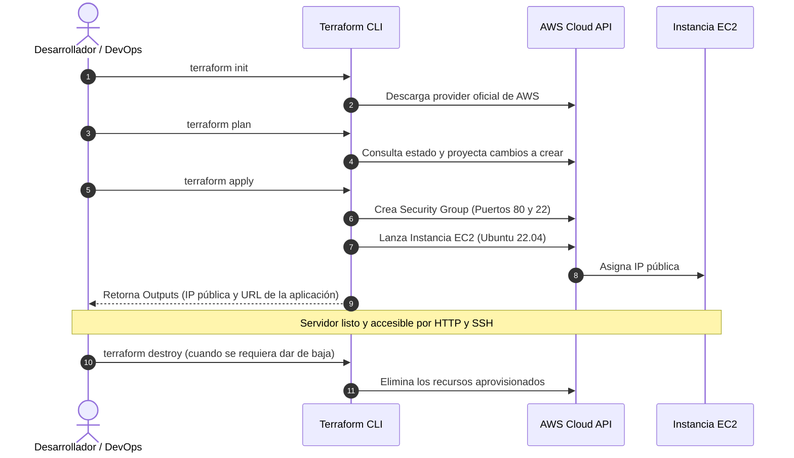

# Especificación Técnica orientada a IA: Aprovisionamiento de Infraestructura con Terraform en AWS

## 1. Metadatos y Tech Stack

**Objetivo:** Automatizar la creación y gestión de la infraestructura base en AWS mediante Infraestructura como Código (IaC) utilizando Terraform, proveyendo un servidor virtual (EC2) accesible por web y SSH con sus respectivas reglas de seguridad.

**Stack:**
- **Terraform:** `>= 1.5.0`
- **AWS Provider:** `hashicorp/aws` (`~> 5.0`)
- **Región AWS:** `us-east-1`
- **Instancia EC2:** Ubuntu 22.04 LTS (`t2.micro`, Free Tier)
- **Security Group:** Ingress HTTP (puerto 80) y SSH (puerto 22), Egress libre hacia internet

**Restricciones:**
- No incluir credenciales de AWS en el repositorio ni en archivos versionados.
- Excluir archivos de estado (`.tfstate`) y variables locales en `.gitignore`.
- Mantener la infraestructura declarativa, reproducible y con capacidad de destrucción controlada.

---

## 2. Archivos Involucrados (Rutas / Paths)

El Agente tiene permitido leer y modificar ÚNICAMENTE los siguientes archivos:

- [NUEVO/EDITAR] `terraform/main.tf` (Definición del proveedor AWS, Security Group, instancia EC2 y outputs).
- [NUEVO/EDITAR] `terraform/README.md` (Documentación del ciclo de vida y comandos de ejecución).
- [EDITAR] `.gitignore` (Reglas de exclusión de Terraform).

---

## 3. Flujo del Sistema

---

## 4. Definición de Recursos de Infraestructura

### 4.1 Proveedor de Nube (`provider "aws"`)
- Región por defecto: `us-east-1`.

### 4.2 Grupo de Seguridad (`aws_security_group`)
- **Nombre:** `clima-app-sg`
- **Reglas de Entrada (Ingress):**
  - Puerto `80` (HTTP, TCP): Abierto a `0.0.0.0/0` para acceso web público.
  - Puerto `22` (SSH, TCP): Abierto a `0.0.0.0/0` para administración remota por consola.
- **Reglas de Salida (Egress):**
  - Todos los puertos y protocolos (`-1`, `0.0.0.0/0`) permitidos para descargas y actualizaciones del servidor.

### 4.3 Instancia de Cómputo (`aws_instance`)
- **Nombre:** `servidor-practica-clima`
- **AMI:** Ubuntu 22.04 LTS en `us-east-1` (`ami-0c7217cdde317cfec`).
- **Tipo de instancia:** `t2.micro` (apta para la capa gratuita de AWS).
- **Asociación de red:** Asignación automática de IP pública habilitada (`associate_public_ip_address = true`).
- **Security Groups:** Vinculado al `aws_security_group.servidor_sg`.

---

## 5. El Contrato (Outputs de Infraestructura)

Al finalizar la ejecución de `terraform apply`, el sistema debe exponer los siguientes valores de salida:

| Output | Descripción | Formato / Ejemplo |
|---|---|---|
| `ip_publica_servidor` | Dirección IP pública asignada a la instancia | `34.201.55.120` |
| `url_aplicacion` | URL web directa para pruebas de acceso | `http://34.201.55.120` |

---

## 6. Instrucciones de Ejecución para el Agente (Criterios de Aceptación)

1. **`devops`:** Mantener `terraform/main.tf` con la sintaxis oficial de HCL, modularizado lógicamente en provider, security group, instancia EC2 y outputs.
2. **`devops`:** Asegurar que `terraform/README.md` detalle los pasos de ejecución (`init`, `plan`, `apply`, `destroy`) y la configuración previa de credenciales con `aws configure`.
3. **`devops`:** Verificar que el archivo `.gitignore` proteja `.terraform/`, `*.tfstate`, `*.tfvars` y logs.

**Criterios de aceptación:**
- ✅ `terraform/main.tf` contiene toda la definición necesaria para levantar la infraestructura base.
- ✅ La configuración es idempotente: `terraform plan` y `terraform apply` crean los recursos esperados sin errores de sintaxis.
- ✅ Los outputs exponen la IP pública y la URL HTTP correspondiente.
- ✅ La infraestructura puede eliminarse de forma limpia mediante `terraform destroy`.
