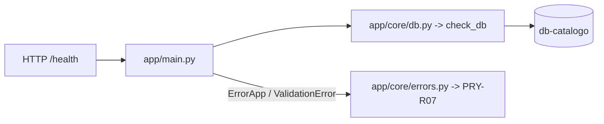

# SPEC-02 · catalogo-service / core

## 1. Metadatos y Tech Stack

**Objetivo:** Crear la base modular de `catalogo-service` en Python 3.12 + FastAPI con su BD PostgreSQL aislada (`db-catalogo`), manejo estándar de errores y endpoint `/health`.

- **Versión spec:** 1.0
- **Stack:** Python 3.12, FastAPI, Uvicorn, `psycopg[binary]` v3, Pydantic v2, `pytest`, `httpx`.
- **Contratos externos:** `specs-v2/01-proyecto-contratos.md §4 y §5`.

## 2. Archivos Involucrados

- [NUEVO] `services/catalogo-service/requirements.txt`
- [NUEVO] `services/catalogo-service/db/init.sql` (tabla `productos`: `id SERIAL PK`, `sku VARCHAR(40) UNIQUE`, `nombre`, `categoria`, `precio NUMERIC(12,2)`, `stock INTEGER CHECK (stock >= 0)`, `activo BOOLEAN DEFAULT TRUE`, `created_at` + 4 productos semilla).
- [NUEVO] `services/catalogo-service/app/__init__.py`
- [NUEVO] `services/catalogo-service/app/core/__init__.py`
- [NUEVO] `services/catalogo-service/app/core/config.py` (lee `DATABASE_URL`, `PORT` desde entorno).
- [NUEVO] `services/catalogo-service/app/core/db.py` (conexión/pool `psycopg` y `check_db()`).
- [NUEVO] `services/catalogo-service/app/core/errors.py` (`ErrorApp` y handlers FastAPI formato PRY-R07).
- [NUEVO] `services/catalogo-service/app/main.py` (`create_app()`, `GET /health` y `GET /api/catalogo/health`).
- [NUEVO] `services/catalogo-service/tests/conftest.py` (cliente FastAPI + limpieza de `db-catalogo`).

## 3. Flujo del Sistema

## 4. Reglas de Negocio

- **CATC-R01** · `app/core/` no contiene lógica de negocio ni conoce módulos específicos (solo provee `db`, `config`, `errors`).
- **CATC-R02** · `GET /health` y `GET /api/catalogo/health` responden `200` si `SELECT 1` en `db-catalogo` funciona, o `503` si falla (PRY-R03).
- **CATC-R03** · Todo error (`ErrorApp`, `RequestValidationError`, inesperado) sale con el JSON de PRY-R07.

## 5. El Contrato

Implementa `GET /health` y `GET /api/catalogo/health` según `specs-v2/01-proyecto-contratos.md §5`.

## 6. Instrucciones de Ejecución para el Agente

1. **`desarrolladorback`:** Crear los archivos de §2 dentro de `services/catalogo-service/`.
2. **`tester`:** Escribir pruebas en `services/catalogo-service/tests/catalogo-core/test_core.py`:
   - **CATC-T01** `GET /health` responde 200 con `{ status: "ok", service: "catalogo-service", db: "up" }`
   - **CATC-T02** `GET /api/catalogo/health` responde 200 y error 404 inexistente usa formato PRY-R07
3. **`revisor`:** Verificar aislamiento en `app/core/`, SQL parametrizado y `pytest` 2/2 verde.
