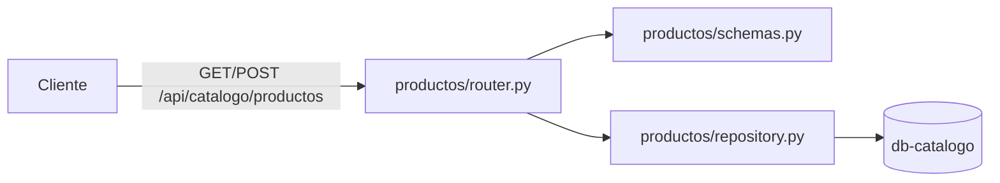

# SPEC-03 · catalogo-service / productos (CRUD)

## 1. Metadatos y Tech Stack

**Objetivo:** Implementar el módulo `productos` de `catalogo-service` para listar, filtrar, consultar y registrar productos en `db-catalogo`.

- **Versión spec:** 1.0
- **Módulo:** `services/catalogo-service/app/modules/productos/`
- **Contratos externos:** `specs-v2/01-proyecto-contratos.md §5` (sin duplicarlos).

## 2. Archivos Involucrados

- [NUEVO] `services/catalogo-service/app/modules/__init__.py`
- [NUEVO] `services/catalogo-service/app/modules/productos/__init__.py`
- [NUEVO] `services/catalogo-service/app/modules/productos/schemas.py` (`ProductoCreate`, `ProductoOut` con `precio` string 2 decimales).
- [NUEVO] `services/catalogo-service/app/modules/productos/repository.py` (SQL `%s`: listar con filtros, buscar por id, insertar producto).
- [NUEVO] `services/catalogo-service/app/modules/productos/router.py` (`GET /productos`, `GET /productos/{id}`, `POST /productos`).
- [MODIFICAR] `services/catalogo-service/app/main.py` (montar `productos.router` bajo `/api/catalogo`).

## 3. Flujo del Sistema

## 4. Reglas de Negocio

- **CATP-R01** · `sku` único; violación de unicidad en PostgreSQL → `409 SKU_DUPLICADO`.
- **CATP-R02** · `precio > 0` y `stock >= 0`; validación fallida → `422 VALIDACION_ERROR`.
- **CATP-R03** · Listado filtra `activo = TRUE` por defecto, `?categoria=` exacto y `?q=` `ILIKE` sobre `nombre`.
- **CATP-R04** · `precio` se almacena `NUMERIC(12,2)` y se devuelve como string con 2 decimales (`"29.90"`, PRY-R04).

## 5. El Contrato

Implementa `GET /api/catalogo/productos`, `GET /api/catalogo/productos/{id}` y `POST /api/catalogo/productos` según `specs-v2/01-proyecto-contratos.md §5`.

## 6. Instrucciones de Ejecución para el Agente

1. **`desarrolladorback`:** Crear el módulo `productos` de §2 y montarlo en `app/main.py`.
2. **`tester`:** Escribir pruebas en `services/catalogo-service/tests/catalogo-productos-crud/test_crud.py` (BD real):
   - **CATP-T01** `POST /api/catalogo/productos` válido retorna 201 y `precio` string con 2 decimales
   - **CATP-T02** `POST /api/catalogo/productos` con SKU duplicado retorna 409 `SKU_DUPLICADO`
   - **CATP-T03** `POST /api/catalogo/productos` con precio `0` o stock negativo retorna 422
   - **CATP-T04** `GET /api/catalogo/productos` filtra por `categoria` y `q`
   - **CATP-T05** `GET /api/catalogo/productos/{id}` inexistente retorna 404 `PRODUCTO_NO_ENCONTRADO`
3. **`revisor`:** Verificar CATP-R01..R04, SQL `%s` y `pytest` 5/5 verde.
