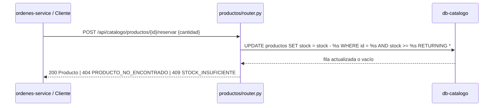

# SPEC-04 · catalogo-service / productos (Stock y Reservas)

## 1. Metadatos y Tech Stack

**Objetivo:** Extender el módulo `productos` con actualización manual de stock y reserva atómica de inventario consumida por `ordenes-service`.

- **Versión spec:** 1.0
- **Módulo:** `services/catalogo-service/app/modules/productos/`
- **Contratos externos:** `specs-v2/01-proyecto-contratos.md §5`.

## 2. Archivos Involucrados

- [MODIFICAR] `services/catalogo-service/app/modules/productos/schemas.py` (agregar `StockUpdate`, `ReservaRequest`).
- [MODIFICAR] `services/catalogo-service/app/modules/productos/repository.py` (agregar `actualizar_stock` y `reservar_stock` atómico).
- [MODIFICAR] `services/catalogo-service/app/modules/productos/router.py` (agregar `PATCH /productos/{id}/stock` y `POST /productos/{id}/reservar`).

## 3. Flujo del Sistema

## 4. Reglas de Negocio

- **CATS-R01** · `stock >= 0` en `PATCH .../stock` y `cantidad >= 1` en `POST .../reservar` (`422 VALIDACION_ERROR`).
- **CATS-R02** · Descuento atómico en una sola sentencia SQL `UPDATE ... WHERE id = %s AND stock >= %s RETURNING *`.
- **CATS-R03** · Si no hay filas afectadas, verificar existencia del producto: si no existe → `404 PRODUCTO_NO_ENCONTRADO`; si existe → `409 STOCK_INSUFICIENTE`.

## 5. El Contrato

Implementa `PATCH /api/catalogo/productos/{id}/stock` y `POST /api/catalogo/productos/{id}/reservar` según `specs-v2/01-proyecto-contratos.md §5`.

## 6. Instrucciones de Ejecución para el Agente

1. **`desarrolladorback`:** Modificar únicamente los 3 archivos de §2 dentro del módulo `productos`.
2. **`tester`:** Escribir pruebas en `services/catalogo-service/tests/catalogo-stock-reservas/test_stock.py`:
   - **CATS-T01** `PATCH /api/catalogo/productos/{id}/stock` actualiza el stock y retorna 200
   - **CATS-T02** `POST /api/catalogo/productos/{id}/reservar` descuenta stock atómicamente
   - **CATS-T03** `POST /api/catalogo/productos/{id}/reservar` con stock insuficiente retorna 409 `STOCK_INSUFICIENTE`
   - **CATS-T04** `POST /api/catalogo/productos/{id}/reservar` sobre producto inexistente retorna 404
3. **`revisor`:** Verificar atomicidad SQL (CATS-R02) y `pytest` 4/4 verde sin romper pruebas previas.
