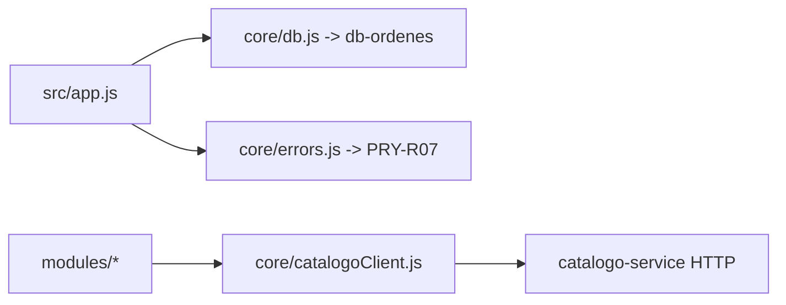

# SPEC-05 · ordenes-service / core

## 1. Metadatos y Tech Stack

**Objetivo:** Crear la base modular de `ordenes-service` en Node.js 22 + Express 4 con su BD PostgreSQL aislada (`db-ordenes`), manejador de errores PRY-R07, `/health` y cliente HTTP hacia `catalogo-service`.

- **Versión spec:** 1.0
- **Stack:** Node.js 22 LTS (CommonJS), Express 4, `pg`, `decimal.js`, `axios`, `zod`, Jest 29, Supertest 7, `nock` 13.
- **Contratos externos:** `specs-v2/01-proyecto-contratos.md §4 y §5`.

## 2. Archivos Involucrados

- [NUEVO] `services/ordenes-service/package.json` (`start`, `test`, `test:unit`, `test:integration`).
- [NUEVO] `services/ordenes-service/jest.config.js`
- [NUEVO] `services/ordenes-service/db/init.sql` (tablas `ordenes` y `orden_items` con `precio_unitario NUMERIC(12,2)`, `subtotal NUMERIC(12,2)`, `total NUMERIC(12,2)`).
- [NUEVO] `services/ordenes-service/src/core/config.js` (lee `DATABASE_URL`, `PORT`, `CATALOGO_URL`).
- [NUEVO] `services/ordenes-service/src/core/db.js` (pool `pg`, `checkDb()`, `enTransaccion(fn)`).
- [NUEVO] `services/ordenes-service/src/core/errors.js` (`ErrorApp`, `manejar(fn)`, `manejadorErrores` PRY-R07).
- [NUEVO] `services/ordenes-service/src/core/catalogoClient.js` (HTTP `POST /api/catalogo/productos/{id}/reservar` usando `CATALOGO_URL`).
- [NUEVO] `services/ordenes-service/src/app.js` y `services/ordenes-service/src/server.js` (`/health` y `/api/ordenes/health`).
- [NUEVO] `services/ordenes-service/tests/setup.js` (limpieza de `db-ordenes`).

## 3. Flujo del Sistema

## 4. Reglas de Negocio

- **ORDC-R01** · `src/core/` es genérico y no accede a `db-catalogo`; toda llamada externa pasa por `catalogoClient.js` usando `config.catalogoUrl` (PRY-R01, PRY-R06).
- **ORDC-R02** · `GET /health` y `GET /api/ordenes/health` verifican `SELECT 1` en `db-ordenes` (`200` o `503`).
- **ORDC-R03** · Si `catalogoClient` recibe `404`/`409` de catálogo, propaga el `ErrorApp` correspondiente; si hay timeout/5xx/red, lanza `ErrorApp('CATALOGO_NO_DISPONIBLE', 502)`.

## 5. El Contrato

Implementa `GET /health` y `GET /api/ordenes/health` según `specs-v2/01-proyecto-contratos.md §5`.

## 6. Instrucciones de Ejecución para el Agente

1. **`desarrolladorback`:** Crear los archivos de §2 en `services/ordenes-service/`.
2. **`tester`:** Escribir pruebas en `services/ordenes-service/tests/ordenes-core/core.test.js` (`pg` real + `nock`):
   - **ORDC-T01** `GET /health` responde 200 con `{ status: "ok", service: "ordenes-service", db: "up" }`
   - **ORDC-T02** `catalogoClient.reservarStock` maneja 200, 409 y error de red 502 con `nock`
3. **`revisor`:** Verificar aislamiento de `db-ordenes`, `core/errors.js` y 2/2 pruebas verdes.
