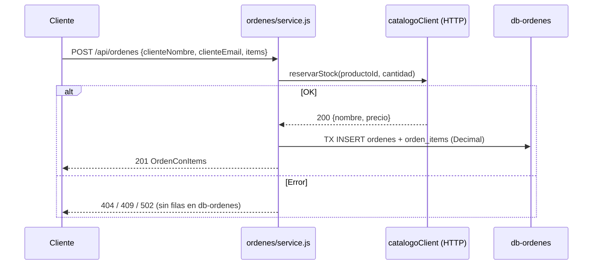

# SPEC-06 · ordenes-service / ordenes (Crear orden)

## 1. Metadatos y Tech Stack

**Objetivo:** Implementar el flujo de creación de órdenes (`POST /api/ordenes`) en el módulo `ordenes`, reservando stock vía HTTP en `catalogo-service` y persistiendo en `db-ordenes` con aritmética `Decimal`.

- **Versión spec:** 1.0
- **Módulo:** `services/ordenes-service/src/modules/ordenes/`
- **Contratos externos:** `specs-v2/01-proyecto-contratos.md §5`.

## 2. Archivos Involucrados

- [NUEVO] `services/ordenes-service/src/modules/ordenes/schemas.js` (`crearOrdenSchema` con `zod`).
- [NUEVO] `services/ordenes-service/src/modules/ordenes/repository.js` (`insertarOrdenConItems` en transacción `$1, $2`).
- [NUEVO] `services/ordenes-service/src/modules/ordenes/service.js` (`crearOrden`: reserva en `catalogoClient`, calcula subtotales/total con `Decimal`, inserta en `db-ordenes`).
- [NUEVO] `services/ordenes-service/src/modules/ordenes/routes.js` (`POST /api/ordenes`).
- [MODIFICAR] `services/ordenes-service/src/app.js` (montar `ordenes/routes.js`).

## 3. Flujo del Sistema

## 4. Reglas de Negocio

- **ORDN-R01** · `items` no vacío, `productoId` entero `>= 1`, `cantidad` entero `>= 1`, `clienteNombre` no vacío, `clienteEmail` válido (`422 VALIDACION_ERROR`).
- **ORDN-R02** · `precio_unitario`, `subtotal` y `total` se calculan exclusivamente en servidor con `Decimal` usando el precio devuelto por `catalogo-service` (PRY-R04).
- **ORDN-R03** · Si cualquier llamada a `catalogoClient` falla antes de persistir, no se crea ninguna fila en `ordenes` ni `orden_items`.

## 5. El Contrato

Implementa `POST /api/ordenes` según `specs-v2/01-proyecto-contratos.md §5`.

## 6. Instrucciones de Ejecución para el Agente

1. **`desarrolladorback`:** Implementar §2 en `src/modules/ordenes/` y montar en `src/app.js`.
2. **`tester`:** Escribir pruebas en `services/ordenes-service/tests/ordenes-crear/crear.test.js`:
   - **ORDN-T01** `POST /api/ordenes` válido reserva stock vía `nock`, calcula `total` exacto con `Decimal` y retorna 201
   - **ORDN-T02** `POST /api/ordenes` con `items` vacío o `cantidad <= 0` retorna 422 sin llamar a catálogo
   - **ORDN-T03** `POST /api/ordenes` cuando catálogo responde 409 retorna 409 y no inserta en `db-ordenes`
   - **ORDN-T04** `POST /api/ordenes` cuando catálogo falla/timeout retorna 502 `CATALOGO_NO_DISPONIBLE`
3. **`revisor`:** Verificar `Decimal`, SQL parametrizado y 4/4 pruebas verdes.
