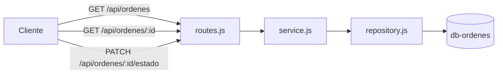

# SPEC-07 · ordenes-service / ordenes (Consultar y Cambiar Estado)

## 1. Metadatos y Tech Stack

**Objetivo:** Completar el módulo `ordenes` con el listado de historial, consulta por ID con ítems y actualización de estado de una orden.

- **Versión spec:** 1.0
- **Módulo:** `services/ordenes-service/src/modules/ordenes/`
- **Contratos externos:** `specs-v2/01-proyecto-contratos.md §5`.

## 2. Archivos Involucrados

- [MODIFICAR] `services/ordenes-service/src/modules/ordenes/schemas.js` (agregar `cambiarEstadoSchema`).
- [MODIFICAR] `services/ordenes-service/src/modules/ordenes/repository.js` (`listarOrdenes`, `obtenerOrdenConItems`, `actualizarEstado`).
- [MODIFICAR] `services/ordenes-service/src/modules/ordenes/service.js` (`listar`, `obtenerPorId`, `cambiarEstado`).
- [MODIFICAR] `services/ordenes-service/src/modules/ordenes/routes.js` (`GET /`, `GET /:id`, `PATCH /:id/estado`).

## 3. Flujo del Sistema

## 4. Reglas de Negocio

- **ORDQ-R01** · `GET /api/ordenes` devuelve órdenes ordenadas por `created_at DESC, id DESC` con totales como string 2 decimales.
- **ORDQ-R02** · `GET /api/ordenes/{id}` inexistente → `404 ORDEN_NO_ENCONTRADA`.
- **ORDQ-R03** · Estados válidos en `PATCH .../estado`: `CREADA`, `PAGADA`, `ENVIADA`, `CANCELADA` (otro valor → `422 VALIDACION_ERROR`).

## 5. El Contrato

Implementa `GET /api/ordenes`, `GET /api/ordenes/{id}` y `PATCH /api/ordenes/{id}/estado` según `specs-v2/01-proyecto-contratos.md §5`.

## 6. Instrucciones de Ejecución para el Agente

1. **`desarrolladorback`:** Modificar únicamente los 4 archivos de §2 dentro de `src/modules/ordenes/`.
2. **`tester`:** Escribir pruebas en `services/ordenes-service/tests/ordenes-consultar/consultar.test.js`:
   - **ORDQ-T01** `GET /api/ordenes` lista órdenes existentes ordenadas descendentemente
   - **ORDQ-T02** `GET /api/ordenes/{id}` devuelve la orden con sus items o 404 si no existe
   - **ORDQ-T03** `PATCH /api/ordenes/{id}/estado` actualiza estado válido y rechaza estado inválido con 422
3. **`revisor`:** Verificar ORDQ-R01..R03 y 3/3 pruebas verdes.
