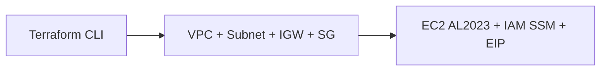

# SPEC-00 · Base Terraform EC2 (Referencia importada)

## 1. Metadatos y Tech Stack

**Objetivo:** Registrar la plantilla base de Terraform EC2 copiada como punto de partida para la infraestructura AWS antes de evolucionarla a k3s en SPEC-07.

- **Versión spec:** 1.0
- **Terraform:** `>= 1.6.0, < 2.0.0` (`hashicorp/aws` `~> 5.0`)
- **Estado:** Base copiada (`done`); será adaptada a k3s en `SPEC-07`.

## 2. Archivos Involucrados

- [NUEVO] `infra/terraform/ec2/versions.tf`
- [NUEVO] `infra/terraform/ec2/providers.tf`
- [NUEVO] `infra/terraform/ec2/variables.tf`
- [NUEVO] `infra/terraform/ec2/main.tf`
- [NUEVO] `infra/terraform/ec2/outputs.tf`
- [NUEVO] `infra/terraform/ec2/terraform.tfvars.example`
- [NUEVO] `infra/terraform/ec2/user-data.sh.tftpl`
- [NUEVO] `infra/terraform/ec2/README.md`

## 3. Flujo del Sistema

## 4. Reglas

- **TFB-R01** · No versionar `terraform.tfvars`, `.terraform/` ni `*.tfstate*`.
- **TFB-R02** · Mantener IMDSv2 (`http_tokens = "required"`), EBS cifrado y administración vía SSM.

## 5. El Contrato

Outputs base: `public_ip`, `url`, `instance_id`, `aws_region`.

## 6. Instrucciones de Ejecución para el Agente

- **TFB-V01** · Los archivos de §2 existen sin credenciales ni `terraform.tfvars` versionado.
