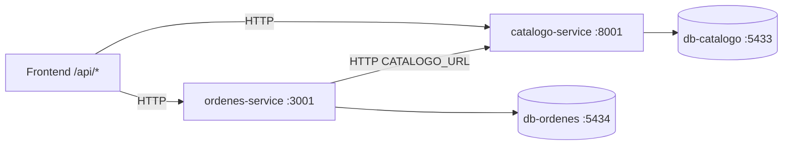

# SPEC-01 · Proyecto base, reglas globales y contratos REST únicos

## 1. Metadatos y Tech Stack

**Objetivo:** Centralizar en un único lugar las reglas globales de **ecommerce-k8s**, los contratos HTTP compartidos entre servicios/frontend (evitando duplicación entre specs) y el `docker-compose.yml` base con ambas bases de datos PostgreSQL aisladas.

- **Versión spec:** 1.0
- **Regla SDD:** Todo contrato externo entre `frontend`, `ordenes-service` y `catalogo-service` vive aquí. Las specs internas de `services/*/specs/` solo citan esta sección §5 y definen su esquema/reglas propias.

## 2. Archivos Involucrados

- [NUEVO] `docker-compose.yml` (servicios `db-catalogo` en host `5433` y `db-ordenes` en host `5434` con `postgres:16-alpine`, variables de entorno locales definidas directamente sin archivo `.env`, volúmenes separados y healthchecks `pg_isready`).
- [NUEVO] `docs/api-contracts.md` (índice legible hacia esta spec).

## 3. Flujo del Sistema

## 4. Reglas de Negocio (Reglas de oro)

- **PRY-R01** · Aislamiento estricto: cada servicio usa su propia carpeta (`services/<servicio>/`) y su propia BD PostgreSQL. Prohibido acceso cruzado a la BD de otro servicio.
- **PRY-R02** · Capas limpias dentro de cada servicio: rutas/controllers → lógica de negocio → repositorio/cliente HTTP.
- **PRY-R03** · Todo servicio expone `GET /health` → `200` `{ "status": "ok", "service": "<nombre>", "db": "up" }` (`503` si falla su BD).
- **PRY-R04** · Dinero y precios: `NUMERIC(12,2)` en BD, `Decimal` en código, string con 2 decimales (`"49.90"`) en JSON. Nunca `float` para totales.
- **PRY-R05** · SQL siempre parametrizado (`%s` en Python, `$1/$2` en Node).
- **PRY-R06** · Variables y URLs internas se inyectan vía `environment` en `docker-compose.yml` / Kubernetes (sin depender de archivo `.env` local); nunca se versionan credenciales AWS reales ni claves privadas.
- **PRY-R07** · Error JSON único: `{ "error": { "codigo": "CODIGO_UPPER", "mensaje": "Texto legible" } }`.
- **PRY-R08** · Máximo 150 líneas por spec; las specs son de solo lectura para agentes (`SDD`).

## 5. El Contrato (Fuente única de verdad HTTP)

**Catálogo (`catalogo-service` `:8001`):**
- `GET /health` · `GET /api/catalogo/productos?categoria=&q=` → `200 { items: [Producto], total }`
- `GET /api/catalogo/productos/{id}` → `200 Producto` (`id, sku, nombre, categoria, precio, stock, activo`)
- `POST /api/catalogo/productos` (`{ sku, nombre, categoria, precio, stock }`) → `201 Producto`
- `PATCH /api/catalogo/productos/{id}/stock` (`{ stock }`) → `200 Producto`
- `POST /api/catalogo/productos/{id}/reservar` (`{ cantidad }`) → `200 Producto` | `409 STOCK_INSUFICIENTE`

**Órdenes (`ordenes-service` `:3001`):**
- `GET /health` · `GET /api/ordenes` → `200 { items: [Orden], total }` · `GET /api/ordenes/{id}` → `200 OrdenConItems`
- `POST /api/ordenes` (`{ clienteNombre, clienteEmail, items: [{ productoId, cantidad }] }`) → `201 OrdenConItems` (`id, clienteNombre, clienteEmail, estado, total, items, createdAt`)
- `PATCH /api/ordenes/{id}/estado` (`{ estado }`) → `200 Orden`

## 6. Instrucciones de Ejecución para el Agente

1. **`devops`:** Crear `docker-compose.yml` (2 PostgreSQL aislados, sin `.env`) y `docs/api-contracts.md`.
2. **`revisor`:** Validar `docker compose config --quiet` y cumplimiento de PRY-R01..R08.
