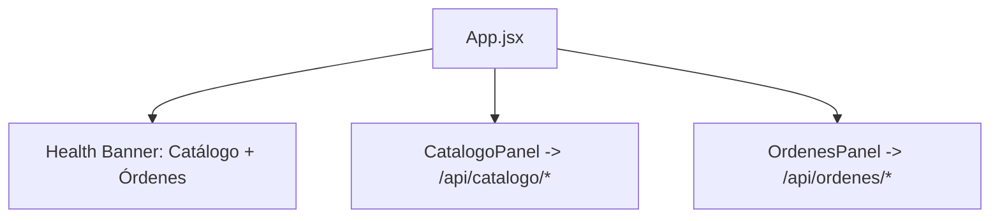

# SPEC-04 · Frontend (React + Vite + Nginx)

## 1. Metadatos y Tech Stack

**Objetivo:** Construir la aplicación web en React + Vite que consulta e integra ambos microservicios (`catalogo-service` y `ordenes-service`) mediante rutas relativas `/api/catalogo` y `/api/ordenes`.

- **Versión spec:** 1.0
- **Stack:** React 18, Vite 5, JavaScript/JSX, Vitest + `@testing-library/react`.

## 2. Archivos Involucrados

- [NUEVO] `frontend/package.json` (scripts `dev`, `build`, `test`).
- [NUEVO] `frontend/vite.config.js` (proxy dev `/api/catalogo` → `http://localhost:8001` y `/api/ordenes` → `http://localhost:3001`).
- [NUEVO] `frontend/index.html`
- [NUEVO] `frontend/src/main.jsx`
- [NUEVO] `frontend/src/api/client.js` (funciones `fetchCatalogo`, `crearProducto`, `actualizarStock`, `fetchOrdenes`, `crearOrden`, `actualizarEstadoOrden`, `fetchHealthServicios` usando rutas relativas).
- [NUEVO] `frontend/src/components/CatalogoPanel.jsx` (listado, búsqueda por nombre/categoría, agregar al carrito y formulario de alta de producto).
- [NUEVO] `frontend/src/components/OrdenesPanel.jsx` (carrito actual, checkout `POST /api/ordenes`, historial de órdenes y cambio de estado).
- [NUEVO] `frontend/src/App.jsx` y `frontend/src/styles.css` (layout limpio con indicador de estado `/health` de ambos servicios).

## 3. Flujo del Sistema

## 4. Reglas de Frontend

- **FE-R01** · Cero URLs absolutas (`http://localhost`, IPs, hostnames) en `frontend/src/`. Solo rutas relativas `/api/catalogo/...` y `/api/ordenes/...` según `specs-v2/01-proyecto-contratos.md §5`.
- **FE-R02** · Toda petición muestra estado de carga y maneja errores JSON (`error.mensaje`) sin romper la interfaz.
- **FE-R03** · Tras crear una orden exitosa, el carrito se limpia y se refrescan tanto la lista de órdenes como el catálogo (para ver el stock descontado).

## 5. El Contrato (Vistas e Integración)

- Barra superior: estado en vivo de `/api/catalogo/health` y `/api/ordenes/health`.
- Sección Catálogo: tabla/cards de productos (`nombre`, `sku`, `categoria`, `precio`, `stock`), filtro y botón "Agregar al carrito".
- Sección Órdenes: formulario de checkout (`clienteNombre`, `clienteEmail`), tabla de órdenes y selector de estado.

## 6. Instrucciones de Ejecución para el Agente

1. **`desarrolladorfront`:** Implementar §2 y validar `npm run build` en `frontend/`.
2. **`tester`:** Escribir pruebas en `frontend/src/App.test.jsx` (con `fetch` mockeado):
   - **FE-T01** Renderiza productos obtenidos desde `/api/catalogo/productos`
   - **FE-T02** Muestra indicador de salud de ambos servicios (`/api/catalogo/health` y `/api/ordenes/health`)
   - **FE-T03** Permite agregar producto al carrito y enviar `POST /api/ordenes`
   - **FE-T04** Tras crear orden exitosa, refresca órdenes y catálogo y vacía el carrito
   - **FE-T05** Muestra mensaje de error legible cuando una API responde 409/422/502
   - **FE-T06** Permite crear un producto nuevo con `POST /api/catalogo/productos`
3. **`revisor`:** Verificar ausencia de URLs hardcodeadas en `frontend/src/`, `npm run build` y 6/6 pruebas verdes.
