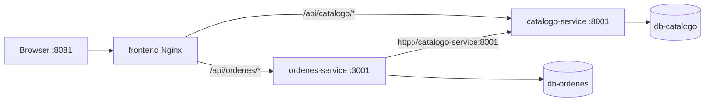

# SPEC-05 · Contenedores e Integración Local (Docker + Nginx)

## 1. Metadatos y Tech Stack

**Objetivo:** Empaquetar los 3 componentes (`catalogo-service`, `ordenes-service`, `frontend` con Nginx reverse proxy) y conectarlos con sus 2 bases de datos PostgreSQL aisladas en `docker-compose.yml` para pruebas E2E locales.

- **Versión spec:** 1.0
- **Imágenes base:** `python:3.12-slim`, `node:22-alpine`, `nginx:1.27-alpine` (build multi-stage para `frontend`).

## 2. Archivos Involucrados

- [NUEVO] `services/catalogo-service/Dockerfile` (usuario no-root, instala `requirements.txt`, expone `8001`).
- [NUEVO] `services/ordenes-service/Dockerfile` (usuario no-root, `npm ci --omit=dev`, expone `3001`).
- [NUEVO] `frontend/nginx.conf` (sirve SPA en `/`, proxy `/api/catalogo/` → `http://catalogo-service:8001/api/catalogo/` y `/api/ordenes/` → `http://ordenes-service:3001/api/ordenes/`, más `/api/catalogo/health` → `/health` y `/api/ordenes/health` → `/health`).
- [NUEVO] `frontend/Dockerfile` (stage builder `node:22-alpine` → `npm run build`; stage final `nginx:1.27-alpine`).
- [MODIFICAR] `docker-compose.yml` (agrega `catalogo-service`, `ordenes-service` y `frontend` en puerto `8081`, esperando los healthchecks de `db-catalogo` y `db-ordenes`).

## 3. Flujo del Sistema

## 4. Reglas

- **CNT-R01** · Contenedores de aplicación corren con usuario no-root (`appuser` / `node`).
- **CNT-R02** · Ningún contenedor incluye archivos `.env` ni secretos horneados en la imagen.
- **CNT-R03** · `db-catalogo` y `db-ordenes` usan redes/alias propios y credenciales independientes por variables de entorno.

## 5. El Contrato

`docker compose up -d --build` expone toda la aplicación en `http://localhost:8081`, respondiendo `/`, `/api/catalogo/health`, `/api/ordenes/health`, `/api/catalogo/productos` y `/api/ordenes`.

## 6. Instrucciones de Ejecución para el Agente

1. **`devops`:** Crear los 3 Dockerfiles, `frontend/nginx.conf` y actualizar `docker-compose.yml`.
2. **`tester`:** Validar `docker compose config --quiet` y ejecutar prueba de humo E2E (`POST` orden real contra `http://localhost:8081` verificando descuento de stock en catálogo) documentada en `tests/reporte.md`.
   - **CNT-T01** Stack completo levanta con `docker compose up -d --build` y ambos `/health` responden 200
   - **CNT-T02** Flujo E2E: crear orden vía `http://localhost:8081/api/ordenes` descuenta stock en `/api/catalogo/productos/{id}`
3. **`revisor`:** Verificar Dockerfiles no-root, Nginx proxy, `docker compose config --quiet` y reporte E2E.
