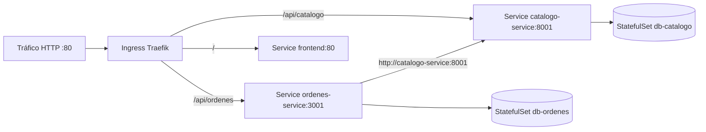

# SPEC-06 · Manifiestos Kubernetes (`infra/k8s/`)

## 1. Metadatos y Tech Stack

**Objetivo:** Definir los manifiestos declarativos de Kubernetes para desplegar ambos servicios independientes, sus dos bases de datos PostgreSQL persistentes, el frontend y el Ingress en un clúster k3s.

- **Versión spec:** 1.0
- **Namespace:** `ecommerce`
- **Ingress Controller:** Traefik (incluido por defecto en k3s).

## 2. Archivos Involucrados

- [NUEVO] `infra/k8s/00-namespace.yaml` (`Namespace: ecommerce`).
- [NUEVO] `infra/k8s/01-configmap.yaml` (`ConfigMap` con puertos, `CATALOGO_URL=http://catalogo-service:8001` y nombres de BD sin contraseñas).
- [NUEVO] `infra/k8s/02-secrets.example.yaml` (plantilla de `Secret` para `db-catalogo-secret` y `db-ordenes-secret` con placeholders `<CAMBIAR>`).
- [NUEVO] `infra/k8s/03-db-catalogo.yaml` (`StatefulSet` + `Service` headless/ClusterIP `db-catalogo:5432` + `PVC` 2Gi + `init` ConfigMap).
- [NUEVO] `infra/k8s/04-db-ordenes.yaml` (`StatefulSet` + `Service` `db-ordenes:5432` + `PVC` 2Gi + `init` ConfigMap).
- [NUEVO] `infra/k8s/05-catalogo-service.yaml` (`Deployment` con readiness/liveness `/health` + `Service ClusterIP` puerto `8001`).
- [NUEVO] `infra/k8s/06-ordenes-service.yaml` (`Deployment` con readiness/liveness `/health` + `Service ClusterIP` puerto `3001`).
- [NUEVO] `infra/k8s/07-frontend.yaml` (`Deployment` + `Service ClusterIP` puerto `80`).
- [NUEVO] `infra/k8s/08-ingress.yaml` (`Ingress` enrutando `/api/catalogo` → `catalogo-service:8001`, `/api/ordenes` → `ordenes-service:3001`, `/` → `frontend:80`).
- [NUEVO] `infra/k8s/README.md` (orden de aplicación y creación segura de Secrets con `kubectl create secret`).

## 3. Flujo del Sistema

## 4. Reglas de Kubernetes

- **K8S-R01** · Ningún manifiesto versionado contiene contraseñas reales; solo `02-secrets.example.yaml` con placeholders.
- **K8S-R02** · Las dos BDs usan `StatefulSet` y `PersistentVolumeClaim` separados; sus Services son `ClusterIP` internos (nunca `NodePort` ni `LoadBalancer`).
- **K8S-R03** · Todo `Deployment` de API y Front define `readinessProbe`, `livenessProbe` y `resources.requests/limits`.
- **K8S-R04** · Las imágenes en Deployments usan variables/placeholders claros (`ghcr.io/<OWNER>/...:<TAG>`).

## 5. El Contrato

Todos los manifiestos en `infra/k8s/` pasan `kubectl apply --dry-run=client -f infra/k8s/` sin errores de esquema.

## 6. Instrucciones de Ejecución para el Agente

1. **`devops`:** Crear los manifiestos de §2 y documentar despliegue en `infra/k8s/README.md`.
2. **`revisor`:** Verificar K8S-R01..R04, ausencia de secretos reales y validación YAML/dry-run.
- **K8S-V01** · Todos los archivos de §2 existen en `infra/k8s/` sin secretos reales.
- **K8S-V02** · `db-catalogo` y `db-ordenes` tienen `StatefulSet`, `PVC` y `Service ClusterIP` separados.
- **K8S-V03** · `08-ingress.yaml` enruta `/api/catalogo`, `/api/ordenes` y `/` correctamente.
