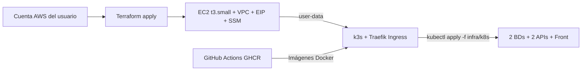

# SPEC-07 · Terraform AWS + k3s + CI/CD (Despliegue en tu cuenta AWS)

## 1. Metadatos y Tech Stack

**Objetivo:** Evolucionar `infra/terraform/ec2/` para aprovisionar en la cuenta AWS propia del usuario una instancia EC2 (VPC dedicada, IP elástica, SSM) con **k3s (Kubernetes)** preinstalado y lista para desplegar `infra/k8s/`, más pipeline CI/CD para construir y publicar imágenes en GHCR.

- **Versión spec:** 1.0
- **Terraform:** `>= 1.6.0, < 2.0.0` (`hashicorp/aws` `~> 5.0`), parametrizado con `var.aws_profile` opcional (nunca credenciales en el repo).

## 2. Archivos Involucrados

- [MODIFICAR] `infra/terraform/ec2/providers.tf` (añadir `profile = var.aws_profile != "" ? var.aws_profile : null` para soportar perfil AWS propio del usuario).
- [MODIFICAR] `infra/terraform/ec2/variables.tf` (añadir `aws_profile`, `project_name` default `"ecommerce-k3s"`, `allowed_k8s_api_cidr` opcional y `k3s_version`).
- [MODIFICAR] `infra/terraform/ec2/main.tf` (Security Group con HTTP 80, HTTPS 443 opcional y puerto 6443 cerrado salvo `allowed_k8s_api_cidr`; instancia `t3.small` mínimo 2GB RAM para k3s + 2 BDs + 3 pods).
- [MODIFICAR] `infra/terraform/ec2/outputs.tf` (exponer `public_ip`, `url`, `instance_id`, `aws_region`, `ssm_connect_command`).
- [MODIFICAR] `infra/terraform/ec2/terraform.tfvars.example` (incluir `aws_profile = ""` y `project_name = "ecommerce-k3s"`).
- [MODIFICAR] `infra/terraform/ec2/user-data.sh.tftpl` (instalación idempotente de **k3s**, `kubectl` accesible y preparación de `/opt/ecommerce/k8s`).
- [MODIFICAR] `infra/terraform/ec2/README.md` (guía paso a paso: configurar perfil AWS propio, `terraform init/plan/apply`, conexión SSM, aplicar `infra/k8s/` y `terraform destroy`).
- [NUEVO] `.github/workflows/ci-cd.yml` (CI: tests de Python, Node, Front + `terraform fmt -check`; CD: build/push imágenes a GHCR con aprobación manual).

## 3. Flujo del Sistema

## 4. Reglas

- **TFK-R01** · Cero credenciales AWS, account IDs ni tokens en el código; el usuario autentica su propia cuenta con `aws_profile` o `aws configure` local.
- **TFK-R02** · Mantener IMDSv2 (`http_tokens = "required"`), volumen raíz `gp3` cifrado (`>= 30` GiB) y administración vía SSM sin SSH `22` abierto a `0.0.0.0/0`.
- **TFK-R03** · Puerto `6443` (API k3s) nunca abierto a `0.0.0.0/0` por defecto; solo si `allowed_k8s_api_cidr` es distinto de vacío.
- **TFK-R04** · Ningún agente ejecuta `terraform apply` o `terraform destroy` sin autorización explícita del humano.

## 5. El Contrato (Outputs Terraform)

`public_ip`, `url` (`http://<public_ip>`), `instance_id`, `aws_region`, `ssm_connect_command`.

## 6. Instrucciones de Ejecución para el Agente

1. **`devops`:** Actualizar `infra/terraform/ec2/` y crear `.github/workflows/ci-cd.yml`. Validar `terraform fmt -check` y `terraform validate`.
2. **`revisor`:** Auditar TFK-R01..TFK-R04, `.gitignore` y que el runbook documente `terraform destroy`.
- **TFK-V01** · `providers.tf` y `variables.tf` soportan perfil AWS propio sin credenciales fijas.
- **TFK-V02** · `user-data.sh.tftpl` instala k3s de forma idempotente y `main.tf` mantiene IMDSv2 + SSM + EBS cifrado.
- **TFK-V03** · `.github/workflows/ci-cd.yml` ejecuta pruebas de los 3 componentes y checks de Terraform.
